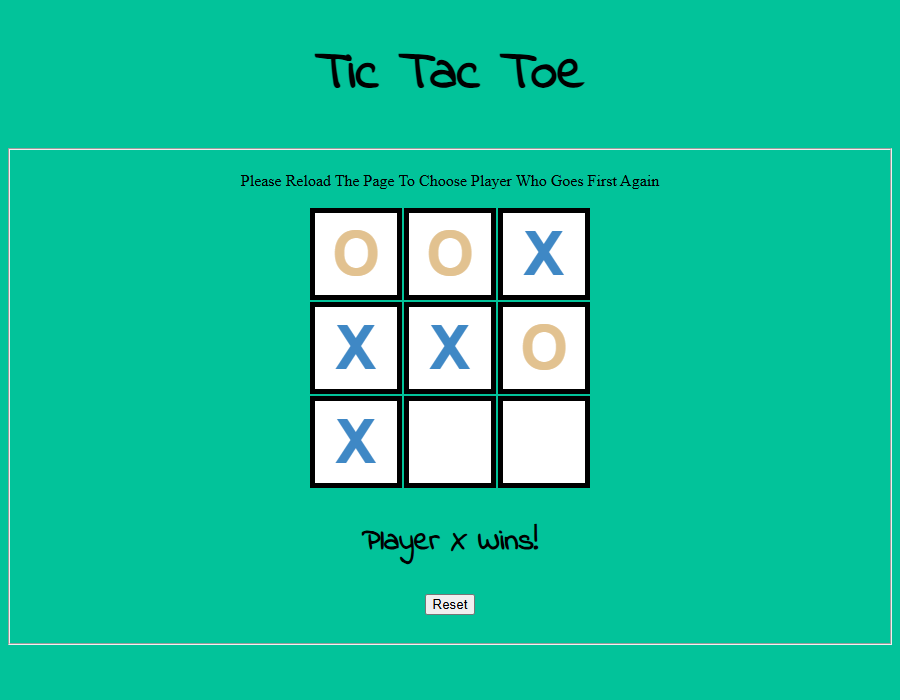

# Tic-Tac-Toe

A two-player Tic Tac Toe game for the browser, plus a small "Hello JS" page that links to it. Plain HTML, CSS and JavaScript in two files, no libraries.

**Play it:** https://mohammad-diab.github.io/Tic-Tac-Toe/tick.html (start page: https://mohammad-diab.github.io/Tic-Tac-Toe/)



## How to play

- When the page opens, choose who goes first: `1` for X or `2` for O.
- Players take turns clicking the empty cells. Three in a row, column or diagonal wins; a full board is a draw.
- The line under the board shows whose turn it is and the result.
- **Reset** clears the board and starts again with the same first player. Reload the page to choose again.

On the start page (`index.html`), **Click Me** toggles a "Hello JS" box in the middle of the window and the **Tic Tac Toe** button opens the game.

## Run it locally

Download `Tic-Tac-Toe-v1.0.0.7z` from [Releases](https://github.com/Mohammad-Diab/Tic-Tac-Toe/releases), or clone the repository:

```
git clone https://github.com/Mohammad-Diab/Tic-Tac-Toe.git
```

Then open `index.html` or `tick.html` in a browser. Nothing to install or build. The handwritten font loads from Google Fonts, so offline the game falls back to a standard font.

## Author

Mohammad Diab

## License

[MIT](LICENSE)
